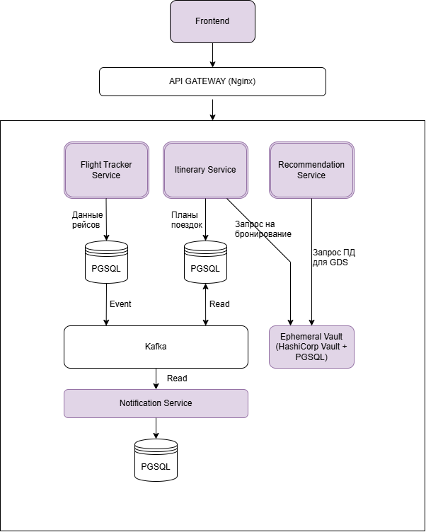

# TravelTech

Данный репозиторий содержит проект системы отслеживания статуса рейсов, автоматического уведомления пользователей и подбора альтернативных маршрутов.

---

## 1. Обзор системы и требований
**Примечание:** Базовые модули платформы (регистрация пользователей, авторизация, управление личным профилем и эквайринг/оплата) в данном документе вынесены за рамки проектирования.
### Цель системы
Спроектировать и реализовать отказоустойчивый модуль реагирования на изменения в расписании, который:
1. **Мониторинг:** В режиме реального времени моделирует рейс пользователей, пользуясь внешниими API поставщиков (GDS, авиакомпании).
2. **Уведомления:** При обнаружении задержки или отмены рейса доставляет уведомление пользователю, даже если он находится в условиях нестабильной связи или оффлайн.
3. **Подбор альтернатив:** Генерирует и предлагает пользователю возможнве альтернативные рейсы или активности, учитывая жесткие ограничения по багажу, визовым правилам и стыковкам в разных таймзонах.
4. **Актуализация маршрута:** Автоматически обновляет план путешествия в интерфейсе системы после выбора и подтверждения альтернативного варианта пользователем.
---

## 2. Требования к системе

### Функциональные требования (ФТ)
* **ФТ-1. Получение статусов рейсов:** Система должна собирать информацию об изменениях (задержки, отмены) через внешние API или путем разбора писем из e-mail рассылок.
* **ФТ-2. Проверка плана поездки:** При изменении времени рейса система должна проверять, не ломается ли остальной маршрут (например, успевает ли человек на пересадку или на забронированную экскурсию).
* **ФТ-3. Отправка уведомлений:** Система должна сразу отправлять пуш-уведомление. Если пуш не дошел за минуту, отправлять резервное SMS или сообщение в мессенджер.
* **ФТ-4. Поиск альтернатив:** Система должна искать замену отмененным рейсам или активностям. Варианты нужно подбирать так, чтобы подходил багаж, не была нужна транзитная виза и подходили часовые пояса. Возможность запрета пользователем на транзит через выбранные страны.
* **ФТ-5. Обновление маршрута:** Когда пользователь выбирает один из предложенных вариантов, система должна обновить общий план поездки в его личном кабинете (и у всей группы, если поездка совместная).

### Нефункциональные требования (НФТ)
* **НФТ-1. Безопасность паспортных данных:** Паспортные данные нельзя хранить в общей базе. Они должны удаляться автоматически через 48 часов после того, как поездка закончилась.
* **НФТ-2. Устойчивость к сбоям внешних API:** Если база авиакомпании или сервис с билетами временно недоступны, наша система не должна ломаться. Нужно делать повторные запросы.
* **НФТ-3. Работа без интернета (Оффлайн-режим):** Мобильное приложение должно сохранять весь маршрут в локальную память телефона. Если у пользователя нет сети, он все равно должен видеть свой план и предупреждения о наложении событий.
* **НФТ-4. Правильный порядок обработки данных:** Если данные от авиакомпаний приходят с задержкой или путаются местами, система должна проверять время обновления и не заменять новые данные старыми.
* **НФТ-5. Единое время (Таймзоны):** Чтобы не запутаться в часовых поясах, внутри системы все расчеты времени должны идти в одном стандарте - UTC. В локальное время аэропорта они переводятся только при показе пользователю.
---

## 3. Архитектура системы

Для обеспечения высокой доступности и изоляции сбоев выбрана событийно-ориентированная архитектура (Event-Driven) на базе Kafka. В описании архитектуры опускаются дополнительные элементы системы для логгирования и сбора метрик. Если это необходимо, можно использовать ELK + Kibana для логгирования и Prometheus + Grafana для сбора и аналитики метрик.

### Компонентная схема

### Описание микросервисов
* **Сервис трекинга рейсов (Flight Tracker)**
  Следит за самолетами. Он слушает внешние API авиакомпаний или ловит от них вебхуки и парсит e-mail рассылки, если билеты привязаны к почте. Если рейс отменили или перенесли, сервис просто пишет об этом в базу и кидает событие в общую очередь.

* **Сервис маршрутов (Itinerary Service)**
  Отвечает за единый таймлайн поездки в профиле пользователя. Он работает с активностями: перелетами, отелями и пр(опционально). Сервис слушает очередь обновлений от трекера. Если прилетает статус о задержке, он проверяет маршрут конкретного пользователя и смотрит, нет ли накладок, например, если самолет опоздает, сгорит ли бронь на такси или следующий внутренний рейс.

* **Сервис подбора альтернатив (Recommendation Service)**
  Это модуль, который составляет варанты альтернативных продолжений маршрутов. Когда сервис маршрутов видит, что таймлайн сломался, он просит этот движок вычислить замену с учетом требований. Движок ищет новые билеты через GDS. Главное — он отфильтровывает варианты: проверяет по базам (типа Timatic), нужна ли транзитная виза, смотрит, чтобы влезал багаж из старого билета, и пересчитывает время стыковок.

* **Сервис уведомлений (Notification Service)**
  Занимается доставкой уведомлений. Как только статус рейса изменился, он пытается отправить пуш в приложение. Если от телефона нет ответа в течение минуты (пользователь оффлайн в самолете или без интернета), сервис автоматически переключается на резервный канал — шлет обычную СМС со ссылкой на альтернативные маршруты.

* **Хранилище паспортов (Ephemeral Vault)**
  Отдельный изолированный контур для персональных данных. Паспорта не хранятся в общей базе с маршрутами. Данные шифруются и привязываются к ID поездки. Для каждой записи выставляется TTL (время жизни): через 48 часов после завершения путешествия сервис сам делает Hard Delete и полностью стирает паспортные данные.
---

## 4. Решение вызовов

### 4.1. Конфликты расписаний, пересадок и таймзоны
* **Таймзоны:** Вся внутренняя математика системы (сравнение интервалов в `Itinerary Service`) работает строго в одном стандарте — UTC. 
* **Конфликты:** В коде сервиса маршрутов работает алгоритм, который проверяет пересечение отрезков времени. При задержке рейса система берет новое время прилета и автоматически добавляет к нему буфер в 45 минут (Minimum Connection Time). Если время начала следующего сегмента (другого рейса, поезда или заселения в отель) оказывается раньше, чем это расчетное время, система фиксирует конфликт расписания.

### 4.2. Персонализация и подбор альтернатив без утечки данных
Чтобы подобрать замену, `Recommendation Service` перед выводом вариантов пропускает билеты через два фильтра:
* **Багажный фильтр:** Движок смотрит в сохраненный JSON старого билета, находит класс тарифа и информацию о багаже. При поиске новых билетов через GDS система автоматически отсекает тарифы без багажа, либо сразу включает стоимость добавления сумок в финальную цену, которую видит пользователь.
* **Визовый фильтр:** Из профиля пользователя система знает его гражданство и список открытых виз. При поиске стыковочных рейсов движок делает короткий запрос к API справочника `Timatic`. Если для транзита через условный Лондон или Дубай гражданину РФ нужна транзитная виза, а у пользователя в профиле её нет, система выкидывает этот вариант из выдачи.

### 4.3. Надежность при отказах внешних API и оффлайн-режим
* **Если не отвечают внешние сервисы (GDS / Авиакомпании):** Если сервис бронирования билетов не отвечает или выдает ошибки 500, гейт API временно перестает слать туда запросы и сразу возвращает в систему код ошибки. Код нашего сервиса делает повторные попытки (Retries) с нарастающей паузой (через 2, 4, 8 секунд), чтобы не заспамить восстанавливающийся партнерский сервис.
* **Если упала Кафка:** Благодаря паттерну Transactional Outbox, сервис трекинга пишет изменения рейсов в свою локальную базу PostgreSQL (в служебную таблицу outbox). Debezium читает лог базы и закинет сообщения в Кафку ровно в тот момент, когда брокер оживет. Данные никогда не потеряются.
* **Если пользователь без интернета:** Мобильное приложение при каждом запуске в сети скачивает актуальный JSON-файл маршрута и сохраняет его в локальную базу на телефоне (SQLite / Room). Если пользователь летит в самолете оффлайн, приложение само берет локальные часы устройства, сравнивает их с последним известным расписанием в кэше и подсвечивает на экране предупреждения о том, что пересадка под угрозой.
